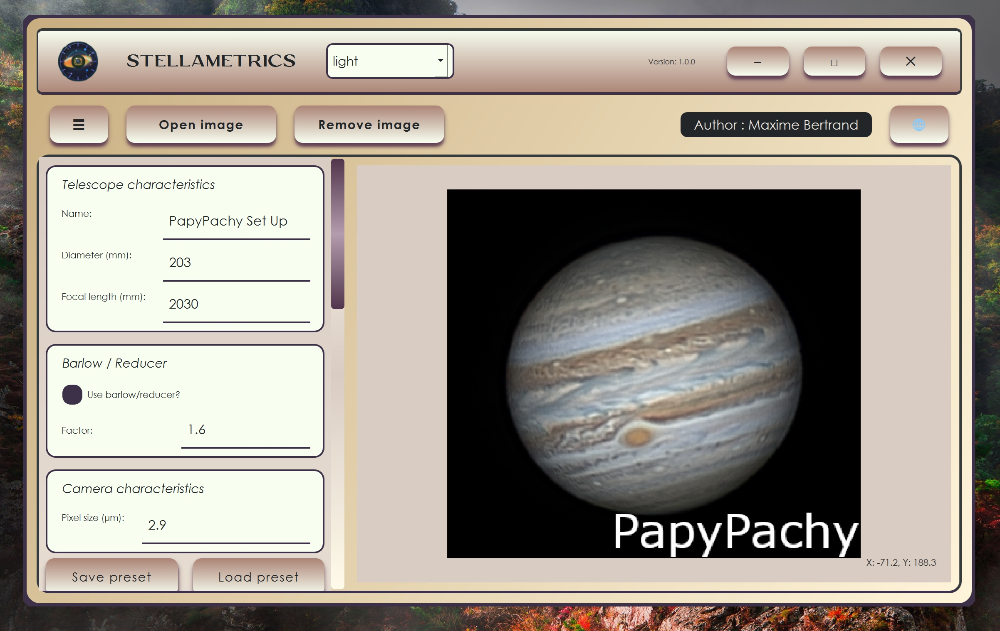
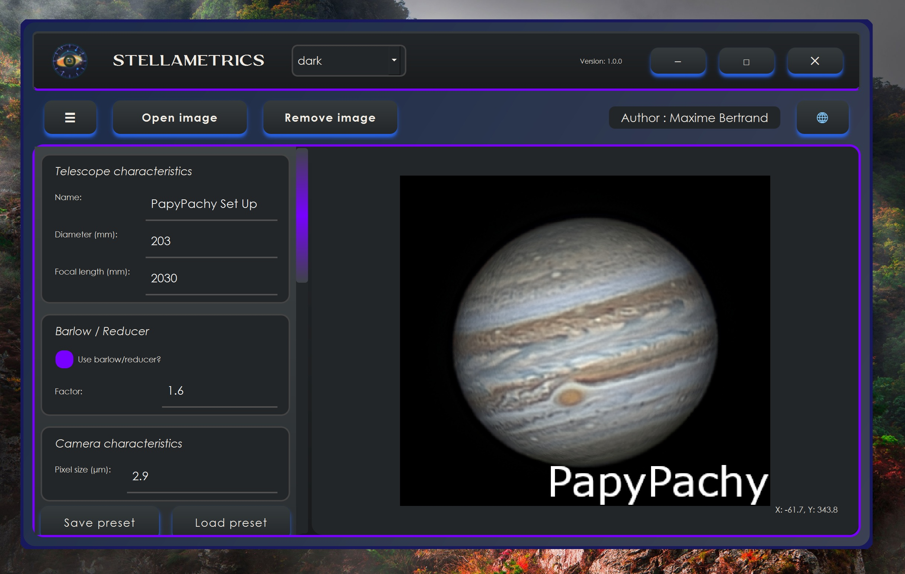
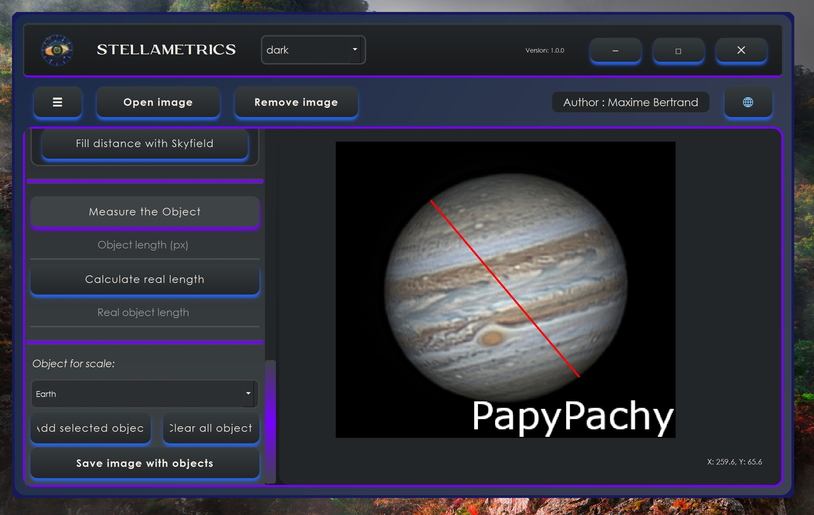
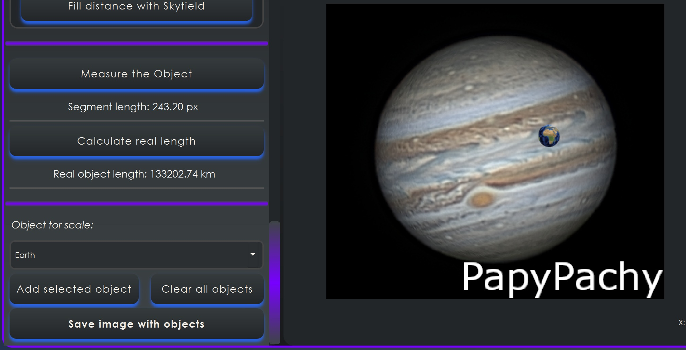
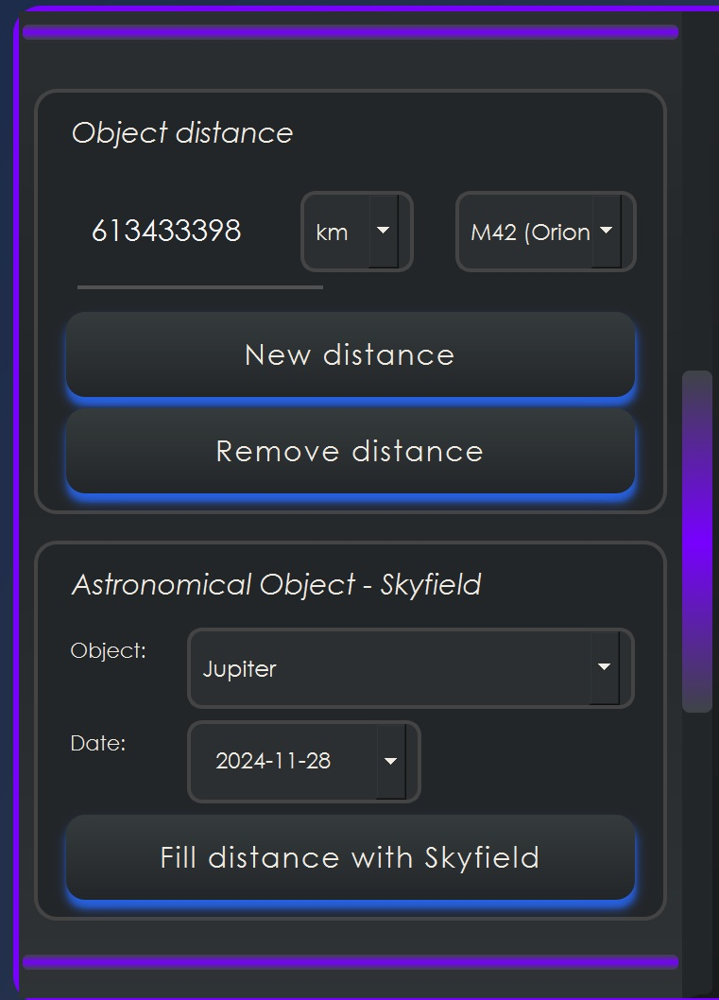

# Stellametrics

Stellametrics est une application de bureau destinée à l'analyse et à la
mesure d'images astronomiques. Elle est écrite en Python avec PyQt5 et
fonctionne avec les images FITS ainsi qu'avec les formats courants comme PNG,
JPG et TIFF.

## Fonctionnalités

- Ouverture et affichage d'images astronomiques.
- Lecture des images FITS et des images classiques.
- Mesure d'un segment directement sur l'image.
- Conversion de la mesure en distance réelle à partir des paramètres de
  l'instrument.
- Gestion du télescope, de la focale, du diamètre, du facteur de Barlow et de
  la taille des pixels de la caméra.
- Bibliothèque personnalisable de distances et d'unités.
- Calculs astronomiques avec Skyfield et l'éphéméride `de421.bsp`.
- Ajout d'objets de référence à l'image : Terre, Jupiter, France et
  États-Unis.
- Rotation, suppression et sauvegarde des images avec objets superposés.
- Enregistrement et chargement de presets d'instrument.
- Thèmes clair et sombre.
- Interface sans bordure avec réduction, maximisation, fermeture et
  redimensionnement de la fenêtre.
- Exécution depuis les sources ou sous la forme d'un exécutable Windows
  autonome.

## Présentation illustrée

Les captures suivantes présentent les principales fonctionnalités de
Stellametrics et le déroulement d'une mesure.

### Modes clair et sombre

Stellametrics propose deux thèmes d'interface. Le mode clair facilite la
lecture dans un environnement lumineux, tandis que le mode sombre est adapté
à l'observation et au traitement d'images dans un environnement peu éclairé.

#### Mode clair



#### Mode sombre



### Mesurer la taille d'un objet

L'outil de segment permet de mesurer la taille apparente d'un objet sur
l'image. On trace un segment entre deux points de l'objet afin d'obtenir sa
taille en pixels et de préparer le calcul de sa taille ou de sa distance
réelle.



### Superposer un objet de référence

Après avoir calculé le rapport de taille à partir de la mesure, il est
possible de superposer un objet de référence sur l'image. Dans cet exemple,
la Terre est ajoutée afin de comparer visuellement sa taille avec l'objet
observé.



### Volet des options et des calculs Skyfield

Le volet latéral regroupe les options de l'application et les paramètres
utiles aux calculs astronomiques. La capture ci-dessous montre notamment les
options liées à Skyfield et à la date utilisée pour les calculs.



## Dossier `!Executable`

Le dossier `!Executable` contient une version déjà compilée de Stellametrics
pour Windows :

```text
!Executable/
├── Stellametrics.exe
└── Examples/
    ├── README_Examples.md
    ├── SunTEST.tif
    └── JupiterTEST.png
```

Si vous souhaitez utiliser l'application sans installer Python, uv ou les
dépendances du projet, lancez directement `!Executable\Stellametrics.exe`.
L'exécutable est autonome et peut être déplacé dans un autre dossier ou
utilisé avec un raccourci Windows.

Le sous-dossier `!Executable\Examples` contient des images de test permettant
d'essayer rapidement l'ouverture, l'affichage et les outils de mesure de
l'application. Pour produire une nouvelle version de l'exécutable à partir
des sources, utilisez plutôt le script
`scripts\build_exe.ps1`, décrit dans la section de compilation.

## Structure du projet

```text
.
├── Assets/                         Images, icônes et exemples
├── Photo_appli/                    Captures d'écran de l'application
├── Library/                        Bibliothèque de distances et de données
│   ├── de421.bsp                   Éphéméride Skyfield
│   └── fonts/                      Polices utilisées par l'application
├── Preset/                         Presets fournis avec le projet
├── ConfigStellametrics/            Configuration en mode développement
├── scripts/
│   └── build_exe.ps1               Script de compilation Windows
├── src/stellametrics/
│   ├── Stellametrics.py            Fichier principal de l'application
│   ├── ImageViewer.ui              Interface Qt
│   └── StyleSheets/                Thèmes QSS
├── pyproject.toml                  Configuration uv et point d'entrée
└── uv.lock                         Versions verrouillées des dépendances
```

## Prérequis

- Python 3.13 ou une version plus récente.
- [uv](https://docs.astral.sh/uv/).
- Windows pour générer l'exécutable avec le script fourni.

`uv` crée et utilise automatiquement l'environnement virtuel du projet. Il
n'est pas nécessaire d'activer manuellement `.venv`.

## Installation et lancement

Depuis la racine du dépôt :

```powershell
uv sync
uv run stellametrics
```

Le point d'entrée `stellametrics` est déclaré dans `pyproject.toml` et appelle
le vrai fichier principal :

```text
src/stellametrics/Stellametrics.py
```

L'exécution directe reste également possible :

```powershell
uv run python src/stellametrics/Stellametrics.py
```

## Compilation de l'exécutable Windows

Le groupe de dépendances `build` contient PyInstaller. Le script de compilation
installe ou synchronise les dépendances nécessaires, vérifie la présence des
ressources, puis construit un exécutable unique.

Depuis la racine du dépôt, dans PowerShell :

```powershell
.\scripts\build_exe.ps1
```

Le résultat est créé ici :

```text
dist\Stellametrics.exe
```

Le script utilise toujours
`src\stellametrics\Stellametrics.py` comme fichier principal et ajoute les
ressources nécessaires au bundle :

- `Assets`
- `ImageViewer.ui`
- les feuilles de style QSS
- `Library\distance_library.json`
- `Library\de421.bsp`
- `Library\fonts`
- `Preset`

Pour lancer manuellement PyInstaller, l'environnement de build peut être
préparé avec :

```powershell
uv sync --group build
uv run --group build pyinstaller --onefile --windowed `
  --name Stellametrics `
  --icon "Assets\Icon\icon.ico" `
  --add-data "Assets;Assets" `
  --add-data "src\stellametrics\ImageViewer.ui;src\stellametrics" `
  --add-data "src\stellametrics\StyleSheets;src\stellametrics\StyleSheets" `
  --add-data "Library\distance_library.json;Library" `
  --add-data "Library\de421.bsp;Library" `
  --add-data "Library\fonts;Library\fonts" `
  --add-data "Preset;Preset" `
  src\stellametrics\Stellametrics.py
```

Le script `build_exe.ps1` est recommandé, car il évite les oublis de
ressources et utilise les versions verrouillées par `uv.lock`.

## Configuration et données utilisateur

En développement, les chemins mémorisés sont stockés dans :

```text
ConfigStellametrics\
```

Avec l'exécutable PyInstaller, la configuration est persistante dans le
répertoire utilisateur Windows :

```text
%LOCALAPPDATA%\Stellametrics\ConfigStellametrics\
```

On y trouve notamment les derniers chemins d'image et de preset ainsi que le
dernier thème choisi. Ce dossier n'est pas placé dans le répertoire temporaire
`_MEI...` de PyInstaller et n'est donc pas supprimé à la fermeture.

La bibliothèque de distances modifiable est copiée dans un dossier temporaire
utilisateur par l'application afin de ne pas modifier les ressources incluses
dans l'exécutable.

## Utilisation rapide

1. Lancez l'application avec `uv run stellametrics` ou ouvrez
   `dist\Stellametrics.exe`.
2. Ouvrez une image avec le bouton d'ouverture.
3. Configurez les paramètres de l'instrument.
4. Activez le mode de mesure et dessinez un segment sur l'image.
5. Sélectionnez une distance dans la bibliothèque ou renseignez les données
   nécessaires pour calculer la distance réelle.
6. Ajoutez éventuellement un objet de référence.
7. Sauvegardez l'image, le preset ou les modifications de la bibliothèque.

Des images d'exemple sont disponibles dans `Assets\Examples` et
`!Executable\Examples`.

## Dépannage

### `uv` n'est pas reconnu

Installez uv, ouvrez un nouveau terminal, puis vérifiez :

```powershell
uv --version
```

### Une ressource est introuvable dans l'exécutable

Reconstruisez l'application avec :

```powershell
.\scripts\build_exe.ps1
```

Le script vérifie automatiquement les ressources avant de lancer PyInstaller.

### Réinitialiser la configuration

Fermez l'application puis supprimez le dossier suivant :

```text
%LOCALAPPDATA%\Stellametrics\ConfigStellametrics
```

La prochaine exécution recréera les fichiers nécessaires.

## Développement

Synchroniser les dépendances :

```powershell
uv sync
```

Lancer l'application :

```powershell
uv run stellametrics
```

Vérifier que le point d'entrée est importable :

```powershell
uv run python -c "from stellametrics.Stellametrics import main; print(main)"
```

## Licence et auteur

Le projet est distribué sous licence Creative Commons
Attribution-NonCommercial 4.0 International (CC BY-NC 4.0). Voir
[LICENCE](LICENCE).

Auteur : [astrosearch42](https://github.com/astrosearch42)
